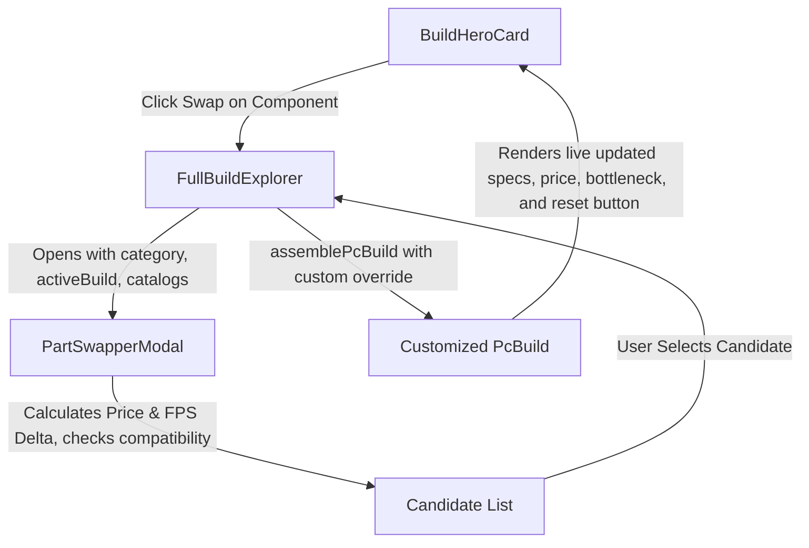

# Specification — Interactive Part Swapper UI ([BLD-05])

## 1. Problem Statement
In **Phase 2**, users in Full Builds mode ("Montar PC") receive an optimal 8-component build based on Pareto efficiency. However, hardware builders frequently ask: *"What happens if I swap this GPU for an RX 7800 XT?"* or *"What if I pick a cheaper 1TB SSD or an AM5 motherboard?"*

To complete **`[BLD-05]`**:
1. Add an interactive **"Swap / Trocar"** action on each of the 8 components displayed in the build hero card.
2. Build an accessible **Part Swapper Modal** (`PartSwapperModal.tsx`) that:
   - Lists all candidate components in that category.
   - Computes real-time price deltas ($\pm\$$ / $\pm\text{R}\$$) and workload FPS deltas ($\pm\text{FPS}$) relative to the currently active component.
   - Evaluates physical and platform compatibility via `checkBuildCompatibility` (sockets, RAM generation, PSU headroom, form factors, cooler TDP, case clearance).
   - Flags incompatible components with precise, plain-language violation messages.
3. Allow the user to select an alternative part, instantly updating the build:
   - Recalculates total price, effective FPS, bottleneck ratio, and power load via `assemblePcBuild`.
   - Provides a "Reset to Recommended / Restaurar Recomendado" action to return to the Pareto frontier optimum.
4. Provide 100% localization in pt-BR and en-US through `src/utils/i18n.ts`.

---

## 2. Architecture & Component Interaction



---

## 3. Data Types & Contracts

```typescript
export type SwappableCategory =
  | 'cpu'
  | 'gpu'
  | 'motherboard'
  | 'ram'
  | 'storage'
  | 'cooler'
  | 'case'
  | 'psu';

export interface PartSwapperModalProps {
  isOpen: boolean;
  onClose: () => void;
  category: SwappableCategory | null;
  activeBuild: PcBuild;
  catalogs: ComponentCatalogs;
  currency: 'USD' | 'BRL';
  locale: AppLocale;
  onSelectComponent: (category: SwappableCategory, component: AnyComponentCandidate) => void;
}
```

---

## 4. Verification Plan
- **Unit / Pure Math Invariant:** Vitest tests verifying swapped build assembly, price/FPS delta math, and compatibility violation detection.
- **UI Smoke & Interaction Tests:** `src/__tests__/App.ui.test.tsx` testing opening Part Swapper, selecting an alternative GPU/CPU, and verifying updated hero telemetry and reset functionality.
- **Documentation & File Caps:** `npm run check` (tsc, eslint, prettier, check:docs).
