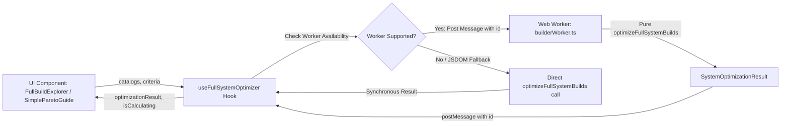

# Specification — Web Worker Combinatorial Builder Engine ([BLD-04])

## 1. Problem Statement
In Phase 2 / Phase 3, the Combinatorial Full-System Builder evaluates hundreds of component permutations (CPU $\times$ GPU $\times$ Motherboard $\times$ RAM $\times$ PSU $\times$ Storage $\times$ Case $\times$ Cooler). While intra-category pruning reduces candidate sets dramatically, performing calculations on the main UI thread during rapid slider adjustments or mode switching can cause minor frame drops on lower-powered devices and mobile phones.

To fulfill **`[BLD-04]`** and product performance requirements:
1. Run `optimizeFullSystemBuilds` asynchronously in a dedicated **Web Worker** (`builderWorker.ts`).
2. Provide a clean, resilient custom hook `useFullSystemOptimizer` that manages worker lifecycle, request serialization, cancellation/race-condition mitigation, and graceful fallback to synchronous execution when Web Workers are unavailable (e.g. headless SSR, test environments like JSDOM).
3. Expose an `isCalculating` flag to the UI to render an unobtrusive "Calculando…" / "Calculating..." badge while keeping the UI responsive.
4. Establish an automated time budget test ensuring the combinatorial engine on full seed catalogs executes under 300ms.

---

## 2. Architecture & Data Flow



---

## 3. Worker Message Interface (`src/workers/builderWorker.ts`)

```typescript
export interface BuilderWorkerInput {
  requestId: number;
  catalogs: FullSystemCatalogs;
  filterCriteria: BuildFilterCriteria;
}

export interface BuilderWorkerOutput {
  requestId: number;
  result: SystemOptimizationResult;
}
```

---

## 4. UI Hook Contract (`src/hooks/useFullSystemOptimizer.ts`)

```typescript
export interface UseFullSystemOptimizerParams {
  catalogs: FullSystemCatalogs;
  filterCriteria: BuildFilterCriteria;
  enabled?: boolean;
}

export interface UseFullSystemOptimizerResult {
  optimizationResult: SystemOptimizationResult;
  isCalculating: boolean;
}
```

### Safety & Invariants
- **Race Condition Guard:** Each request carries an incrementing `requestId`. Responses with `requestId < latestRequestId` are silently ignored.
- **Worker Recycling:** Spawns a single Web Worker per hook lifecycle, terminating on unmount.
- **Fail-Safe Fallback:** If Worker creation throws (due to CSP, cross-origin script policy, or environment limitations), catches the error and executes `optimizeFullSystemBuilds` directly on the main thread without throwing.
- **File Size & Purity:** Pure math remains in `src/lib/math/`. The worker is a thin wrapper (< 60 lines). The hook is a focused deep module (< 150 lines).

---

## 5. Verification Plan
- **Unit/Hook Tests:** `src/hooks/__tests__/useFullSystemOptimizer.test.ts` testing worker lifecycle and sync fallback.
- **Time Budget Test:** `src/lib/math/__tests__/combinatorial.test.ts` asserting `< 300ms` on full seed catalog with highest budget preset ($3,200).
- **All Invariants Check:** `npm run check` (tsc, eslint, prettier, vitest, check:docs).
